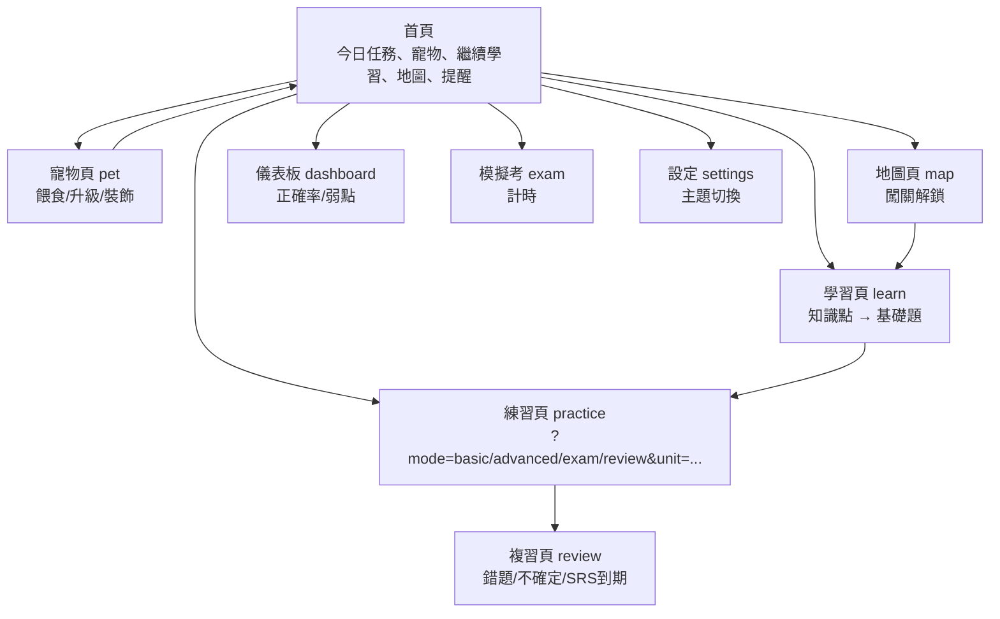

# 線上學習平台規劃文件

## 1. 整體架構

### Phase 1 (MVP，前端靜態輸出)
- **前端**：Next.js 14 App Router + TypeScript + Tailwind CSS，完全客戶端渲染（CSR）為主，支援 SSR 靜態預渲染（無 localStorage 觸碰）。
- **資料儲存**：localStorage 透過抽象層 `StorageAdapter`（LocalStorageAdapter），SSR 安全（僅 client-side）。
- **題庫**：靜態 JSON（data/math-grade1-sem1-chapter1.json），import 載入。
- **無後端**：靜態匯出（next.config.mjs: output: 'export'），部署 GitHub Pages/Netlify。
- **檔案結構**：
  ```
  app/
  ├── layout.tsx (根佈局，ThemeProvider)
  ├── globals.css (CSS 變數、Tailwind)
  ├── page.tsx (首頁)
  ├── learn/page.tsx
  ├── practice/page.tsx (?mode=...&unit=...)
  ├── review/page.tsx
  ├── pet/page.tsx
  ├── map/page.tsx
  ├── dashboard/page.tsx
  ├── exam/page.tsx
  ├── settings/page.tsx
  components/
  ├── BottomNav.tsx
  ├── Pet.tsx
  ├── QuestionCard.tsx
  ├── ProgressRing.tsx
  ├── QuestDaily.tsx
  ├── TopBar.tsx
  lib/
  ├── types.ts
  ├── storage.ts
  ├── srs.ts
  ├── srs.test.ts
  ├── questions.ts
  ├── game.ts
  ├── themes.ts
  ├── useUserData.tsx
  data/
  ├── math-grade1-sem1-chapter1.json
  docs/
  ├── PLAN.md
  ├── CONTRACT.md
  prisma/
  ├── schema.prisma (Phase 2 準備)
  ```

### Phase 2 (後端整合)
- **後端**：Next.js Server Actions + Prisma + PostgreSQL（Vercel Postgres）。
- **儲存**：替換 `ApiStorageAdapter`，透過 fetch/Server Actions 同步 localStorage。
- **認證**：NextAuth.js (Phase 2.5，多用戶)。
- **API Routes**：禁用（靜態輸出），改用 Server Actions（但需調整 output: 'standalone'）。

### Phase 3 (進階功能)
- **後端**：擴充 Prisma（分享進度、排行榜）。
- **PWA**：Service Worker 離線題庫。
- **AI**：整合 Grok API 產生解析/自訂題。

## 2. 核心資料結構說明
詳見 `lib/types.ts`：
- **題目 (Question)**：扁平結構，含層級 id（chapter/unit/kp），tier 分層，type (單選/填空)，source 歷年真題。
- **使用者進度**：`answerRecords[]` (答題紀錄)、`questionMarks{}` (標記)、`unlockedUnits[]` (解鎖單元)。
- **養成**：`pet` (狀態)、`inventory` (物品)、`dailyQuests[]` (任務)。
- **間隔複習 (SRS)**：`srs{}` (questionId → SrsState)，`lib/srs.ts` 計算下次 dueDate。
- **主題**：`currentTheme` + `unlockedThemes[]`，CSS 變數切換。

## 3. 主要頁面流程與功能清單

### 頁面流程 (Mermaid)


### 功能清單
- **Phase 1**：
  - 主題切換 (3套: campus/adventure/focus，可解鎖 sakura/math)。
  - 養成：答題得飼料/exp/金幣，餵寵物/升級/裝飾/場景，每日任務。
  - 題庫：基礎/進階，標記錯/不熟，一鍵複習，SRS (1/3/7日)。
  - 從零教學：lesson → 3~5基礎題，錯跳回。
  - 儀表板、模擬考、行動 UI (BottomNav)。
- **Phase 2**：
  - 後端同步、多用戶、歷年真題匯入。
- **Phase 3**：
  - 分享、PWA、AI 解析。

## 4. 技術棧與理由
| 技術 | 版本 | 理由 |
|------|------|------|
| Next.js | 14.2.15 | App Router + 靜態輸出，優化行動載入。 |
| React | 18.3.1 | Context + hooks 狀態管理（無 Zustand）。 |
| TypeScript | 5.6.3 strict | 型別安全，介面契約。 |
| Tailwind CSS | 3.4.14 | 行動優先，CSS 變數主題。 |
| Prisma | 5.21.1 | Phase 2 ORM，schema 準備。 |
| localStorage | - | Phase 1 無伺服器，轻量。 |

無第三方 UI/Icon，純 Tailwind + SVG。

## 5. Phase 1 MVP 範圍與檔案結構說明
- **範圍**：數學國一上第1章「整數的運算」（10基礎+5進階題），3主題，輕量養成（寵物1種kind，2配件，3場景）。
- **檔案結構**：如上，總 35 檔案（含 docs/data）。
- **部署**：`npm run build` → out/ 靜態文件。

## 6. 歷年真題匯入格式說明
JSON 陣列 Question[]，置 data/exams/：
```json
[
  {
    "id": "exam-113-1-5",
    "subject": "math",
    "grade": 1,
    "semester": 1,
    "chapterId": "ch1",
    "unitId": "u1",
    "knowledgePointId": "kp1",
    "tier": "exam",
    "type": "single",
    "stem": "題幹...",
    "options": ["A", "B", "C", "D"],
    "answer": "A",
    "explanation": "解析...",
    "source": {"year": 113, "exam": "國中會考", "number": 5},
    "tags": ["加法"],
    "difficulty": 3
  }
]
```
`lib/questions.ts` 匯入合併。

## 7. Phase 2、3 路線圖
- **Phase 2**：Prisma schema → Server Actions → 雲端同步（1週）。
- **Phase 3**：NextAuth + 排行 + PWA（2週）。
